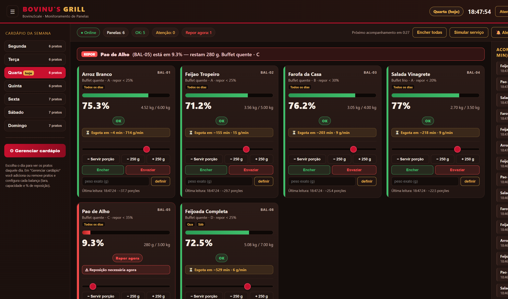

# Projeto Hackathon FMU Tech 2026.2

**Grupo Concessionária Grills**  
**Curso de Engenharia da Computação**

| Nome | RA |
| --- | --- |
| Hellen Cristhine Souza Atanasio | 1821616 |
| Yohann Madureira Mazario | 1755472 |

# BovinuScale · Bovinu's Grill

Protótipo do Grupo Bovinu's para o buffet e para o salão. Cada panela do buffet tem uma balança por baixo. O mesmo sistema numera as mesas, recebe o QR do garçom e avisa o salão quando a conta é paga.

## Site público

O sistema abre de qualquer lugar, sem instalar nada:

| Tela | Endereço |
| --- | --- |
| Cozinha | https://bovinascale.onrender.com/ |
| Salão | https://bovinascale.onrender.com/atendimento.html |
| Caixa | https://bovinascale.onrender.com/caixa.html |
| Relatório do dia | https://bovinascale.onrender.com/report.html |
| Check-in do garçom | https://bovinascale.onrender.com/checkin.html?mesa=1 |

O QR de cada mesa já aponta para esse endereço. Depois de cerca de 15 minutos sem visita, o site gratuito dorme e o próximo acesso leva cerca de um minuto. Quando o serviço reinicia, a demonstração volta ao cardápio e às mesas livres.

## Apresentação

O material da banca está na pasta [`entrega/`](entrega/README.md).

| Material | Onde abrir |
| --- | --- |
| Vídeo (1 min 22 s) | [Assistir no GitHub](entrega/bovinascale-demo.mp4) · [arquivo direto](https://yohannmazario.github.io/bovinascale/entrega/bovinascale-demo.mp4) |
| PowerPoint (5 slides) | [BovinuScale-apresentacao.pptx](entrega/BovinuScale-apresentacao.pptx) |
| Slides no navegador | [apresentacao.html](https://yohannmazario.github.io/bovinascale/entrega/apresentacao.html) |
| Documento de avaliação | [detalhamento.html](https://yohannmazario.github.io/bovinascale/entrega/detalhamento.html) |

[](entrega/bovinascale-demo.mp4)

O vídeo percorre a cozinha, o relatório, o salão, o QR do garçom e o caixa. As setas do teclado passam os slides no navegador.

| Slide | Conteúdo |
| --- | --- |
| 1. Problema | A panela acaba sem a cozinha ver, e o salão não vê a mesa paga. |
| 2. Desenvolvimento | Do servidor até o QR, o caixa e o alerta sonoro. |
| 3. Estrutura | Uma API, o banco e as telas no mesmo dado. |
| 4. Integração | Balança, QR, pagamento e apito no mesmo fluxo. |
| 5. Apresentação final | Alerta de reposição, fechamento do dia e mesa liberada. |

Capturas e diagramas ficam em [`entrega/capturas/`](entrega/capturas) e [`entrega/diagramas/`](entrega/diagramas).

## O que o sistema faz

1. **Acompanhamento de 10 em 10 minutos.** A cozinha vê quanto ainda há em cada panela e se precisa repor.
2. **Consumo do dia por balança.** O relatório soma o que foi servido. Reposição não conta como consumo.
3. **Salão e caixa.** 24 mesas, de 2 a 10 cadeiras. O QR marca a mesa ocupada. O pagamento libera a mesa e o salão apita.

O cardápio muda com o dia da semana. Cada balança é cadastrada em quilos ou gramas: tara, capacidade e percentual de reposição.

## Como rodar nesta máquina

```powershell
pip install -r requirements.txt
.\start.ps1
```

Ou, no ritmo real de 10 minutos:

```powershell
python server.py
```

Nesta máquina:

- Cozinha: http://127.0.0.1:8000/
- Salão: http://127.0.0.1:8000/atendimento.html
- Caixa: http://127.0.0.1:8000/caixa.html
- Relatório: http://127.0.0.1:8000/report.html

`.\start.ps1 -Intervalo 15` encurta o acompanhamento. `.\start.ps1 -Simulador` também envia pesos sozinho.

## Telas

- **Cozinha:** percentual, quilos, status, slider da balança, peso exato, previsão de esgotamento, porções restantes e alerta sonoro.
- **Cardápio:** dias da semana, incluir, editar e retirar pratos, tara e capacidade em kg/g.
- **Relatório:** quilos, porções, reposições, sobra, horário de pico, CSV e impressão.
- **Salão:** mesas numeradas, QR, status livre, ocupada ou liberada, e apito quando o caixa libera.
- **Caixa:** registra o pagamento das mesas ocupadas.

## Balança real

```http
POST /api/readings
Content-Type: application/json

{ "scale_id": "BAL-01", "gross_g": 7234.5 }
```

O peso líquido também pode ser enviado direto: `{ "scale_id": "BAL-01", "net_g": 6000 }`.

O consumo do dia é a soma das quedas de peso. Quando o peso sobe, a casa repôs a panela.

| Status | Faixa |
| --- | --- |
| OK | acima de 30% |
| Atenção | 15% a 30% |
| Repor agora | 15% ou menos |
| Vazia | 5% ou menos |

Cada panela ainda respeita o próprio `refill_pct`.

## API

| Método | Rota | Uso |
| --- | --- | --- |
| POST | `/api/readings` | Leitura da balança |
| GET | `/api/status?weekday=N` | Panelas do dia (segunda = 0) |
| GET | `/api/kitchen-updates` | Histórico dos acompanhamentos |
| GET | `/api/report` | Consumo do dia (`?day=AAAA-MM-DD`) |
| GET | `/api/report.csv` | O mesmo relatório em CSV |
| GET | `/api/pots` | Cardápio |
| POST | `/api/pots` | Cadastra ou edita um prato |
| DELETE | `/api/pots?scale_id=X` | Remove um prato |
| GET | `/api/mesas` | Mesas, cadeiras e status |
| GET | `/api/mesas/1/qr.svg` | QR da mesa |
| POST | `/api/mesas/1/ocupar` | Check-in do garçom |
| POST | `/api/mesas/1/pagar` | Pagamento no caixa |
| POST | `/api/mesas/1/disponibilizar` | Mesa livre de novo |
| POST | `/api/demo/fill` | Enche as panelas do dia |
| POST | `/api/demo/serve` | Simula uma rodada de consumo |

Exemplo de prato. Os dias seguem segunda = 0 até domingo = 6.

```json
{
  "scale_id": "BAL-13",
  "name": "Costela ao Bafo",
  "location": "Estação Grill",
  "tare_g": 1500,
  "capacity_g": 7000,
  "refill_pct": 25,
  "weekdays": [2, 5]
}
```

## Arquivos

```
server.py            servidor, banco, monitor e APIs
qr_svg.py            QR de cada mesa
simulator.py         pesos sem hardware
start.ps1            demonstração local
render.yaml          publicação do site
requirements.txt     biblioteca do QR
web/                 cozinha, relatório, salão, caixa e check-in
entrega/
  README.md
  bovinascale-demo.mp4
  BovinuScale-apresentacao.pptx
  apresentacao.html
  detalhamento.html
  capturas/
  diagramas/
```

O arquivo `bovinus.db` nasce na primeira execução e não entra no repositório.
